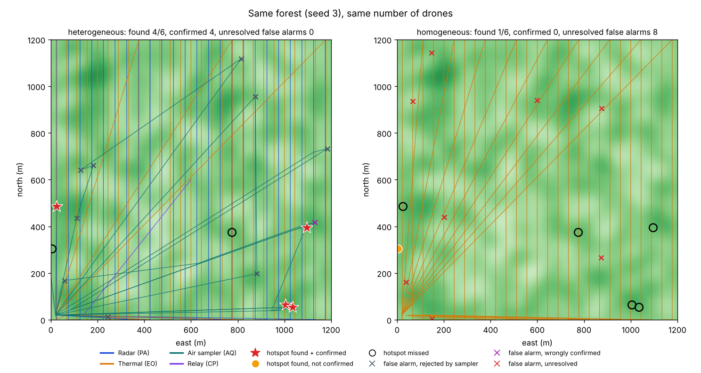

# Swarm-Sim

Simulates heterogeneous drone swarms searching for hidden hazards. Radar, thermal, air-sampling and relay drones
split the work, share detections over a range-limited mesh, and confirm what they find before anyone is called out.

[](https://github.com/aerki-space/Swarm-Sim/actions/workflows/ci.yml)



## The question it answers

Is a **mixed** swarm better than the same number of identical camera drones at finding fires smouldering under
forest canopy?

```
$ python -m swarm_sim compare
30 random forests, 9 drones per fleet
```

| | heterogeneous | homogeneous |
|---|---|---|
| hotspots found | 44% | 11% |
| hotspots confirmed | 44% | 0% |
| median time to find | 8.1 min | 4.0 min |
| median time to confirm | 10.3 min | – |
| false alarms per mission | 5.7 | 5.3 |
| false alarms left unresolved | 0.0 | 5.3 |
| false alarms wrongly confirmed | 0.1 | 0.0 |
| mission time | 18.9 min | 8.8 min |

These results follow from modelling assumptions, not flight data. Read [docs/model.md](docs/model.md) for exactly
what's assumed and what isn't modelled.

## Quick start

```sh
pip install -r requirements.txt
python -m swarm_sim run --plot run.png                  # one mission
python -m swarm_sim compare --plot compare.png          # fleet comparison over 30 forests
python -m swarm_sim missions --out missions/            # ArduPilot / PX4 mission files
python -m swarm_sim run --udp 127.0.0.1:14560           # live telemetry for the ground station
python -m unittest discover -s tests
```

## What's inside

| Module | Does |
|---|---|
| `world.py` | Forest canopy, hidden hotspots, downwind gas plumes |
| `agents.py` | Drone types (radar, thermal, sampler, relay) and their sensor models |
| `planner.py` | Lawnmower coverage per sensor type; nearest-first task allocation |
| `mesh.py` | Range-limited multi-hop mesh: who can hear whom |
| `sim.py` | Time-stepped mission: survey, report, share, two-point gas confirmation, return to launch |
| `telemetry.py` | Live JSON-over-UDP stream ([format](docs/telemetry.md)) for the ground station |
| `missions.py` | QGC WPL 110 mission export, verified to load with pymavlink |
| `plot.py` | Mission and comparison figures |

## Works with

- **[Ground station](https://github.com/aerki-space/ground-station-fleet-dashboard-):** run with `--udp` and watch
  the swarm live on a map.
- **ArduPilot / PX4 SITL:** `missions` writes one mission per drone. Load them into SITL instances with Mission
  Planner, QGroundControl or MAVProxy (`wp load PA-0.waypoints`).
- **[dronecan-dsdl](https://github.com/aerki-space/dronecan-dsdl):** detection fields mirror `aerki.sensor.Hotspot`
  and `aerki.radar.Detections`.

## Roadmap

- Second-look strategies: radar re-scans of candidate areas
- Packet loss and latency in the mesh
- Battery-limited missions with mid-mission swaps
- Multi-vehicle ArduPilot SITL runner driven by the same planner

## License

MIT, see [LICENSE](LICENSE).
